# esp_display – Loxone-Wandpanel für Guition ESP32-4848S040C

Native ESP-IDF-Firmware (6.1, LVGL 8.4) für das 4-Zoll-Touchpanel Guition ESP32-4848S040C (480×480) in der 86-mm-Unterputzdose. Das Panel steuert Licht, Storen und Schalter über einen lokalen Loxone Miniserver. Dazu zeigt es Wetter mit MeteoSchweiz-Warnungen, Webcams, ÖV-Abfahrten, Kalender, Abfuhrtermine und Erinnerungen an – im dunklen Glas-Look („Dark Glass“).

## Screenshots

Echte Screenshots vom Panel (über den Test-Harness aufgenommen). Netzwerk- und Miniserver-Namen sind unkenntlich gemacht.

| | | |
|:-:|:-:|:-:|
| 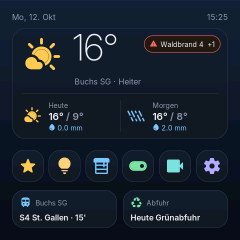<br>Home | 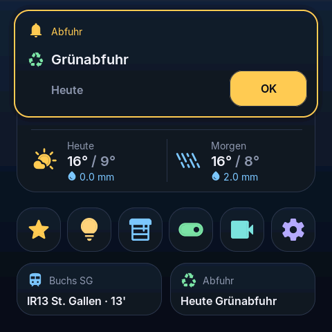<br>Abfuhr-Erinnerung | 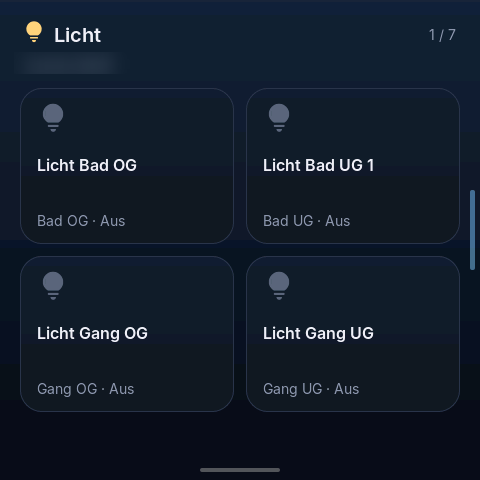<br>Licht |
| 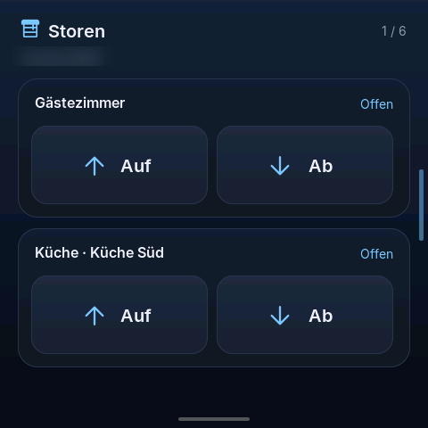<br>Storen | 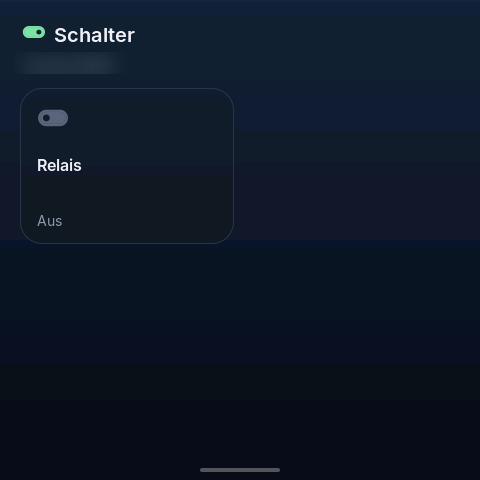<br>Schalter (Relais) | 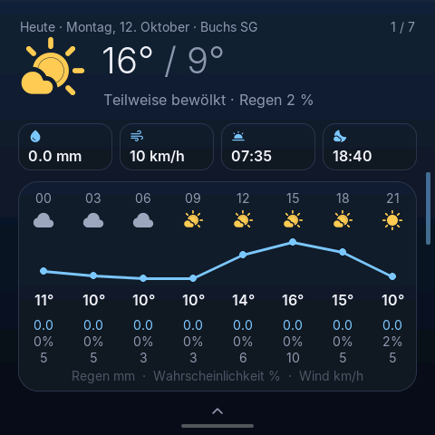<br>Wetter-Tagesansicht |
| 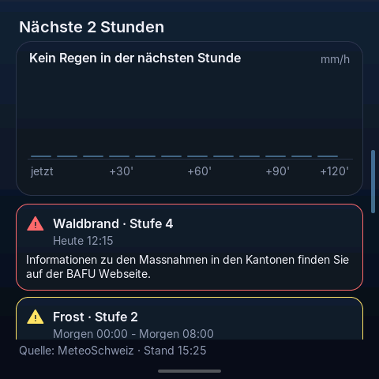<br>Regen & Warnungen | 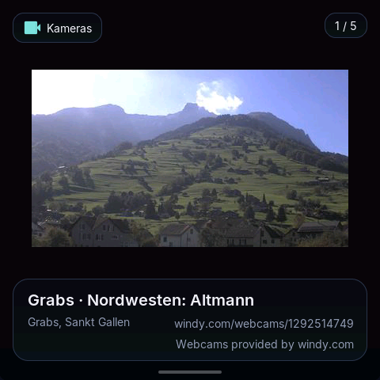<br>Webcams (Windy) | 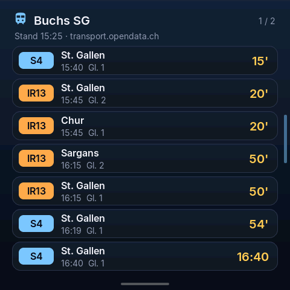<br>ÖV-Abfahrten |
| <br>Bildschirmschoner SBB-Uhr | 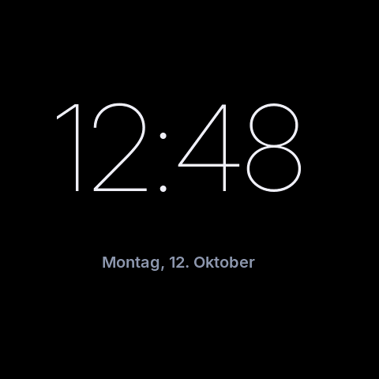<br>Bildschirmschoner digital | 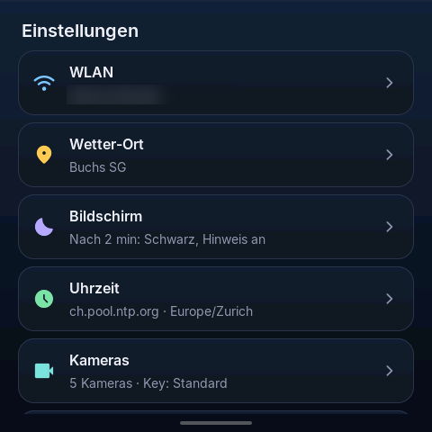<br>Einstellungen |
| 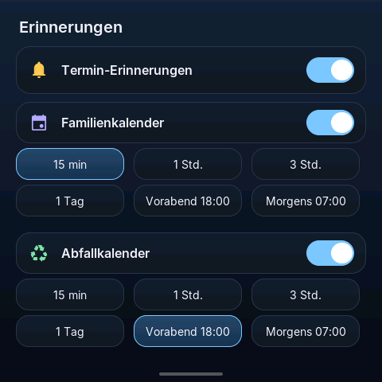<br>Erinnerungs-Einstellungen | 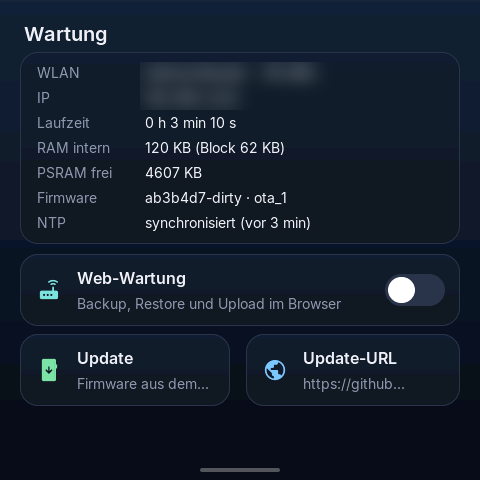<br>Wartung / Status | |

## Features

- **Loxone-Steuerung** – Favoriten, Licht, Storen (Auf/Ab, Position) und Schalter aus `LoxAPP3.json`, live gelesen beim Öffnen einer Seite. HTTP mit Basic Auth gegen den lokalen Miniserver; Token-Auth ist als Schnittstelle (`LoxoneAuthorizer`) vorbereitet.
- **Relais** – das eingebaute Relais (GPIO40) als lokale Kachel unter „Schalter“, beim Boot aus.
- **Wetter** – Open-Meteo (HTTPS, ohne Key): aktuell, Heute/Morgen, Tagesansicht mit Stundenverlauf. Ort frei wählbar (Geocoding).
- **MeteoSchweiz** – Unwetterwarnungen (Badge auf Home, Details in der Regenansicht) und Niederschlagsprognose für die nächsten 2 Stunden in 10-min-Schritten (radarbasiert), über die PLZ (inoffizielle Schnittstelle, siehe unten).
- **Webcams** – Windy Webcams API, Suche nach ID oder Ort (25 km), Bilder 1:1 ohne Hochskalieren, Refresh alle 2 min.
- **ÖV** – Abfahrtstafel über transport.opendata.ch, Haltestellensuche, Kurzinfo auf Home.
- **Kalender & Abfall** – privater iCal-Familienkalender und Abfuhrkalender (Abfallkalender-API Kanton St. Gallen, Gemeinde per BFS-Nr. wählbar, Abruf beim Start und einmal täglich), Übersicht auf eigener Seite und Kurzinfo auf Home.
- **Erinnerungen** – Karte auf Home und Bildschirmschoner mit „OK“-Quittung (gespeichert in NVS). Vorlauf: 15 min, 1 Std., 3 Std., 1 Tag, Vorabend 18:00, Morgens 07:00 – getrennt für Termine und Abfuhr.
- **Bildschirmschoner** – Timeout (Aus … 10 min), Schwarz mit wanderndem „wake me up“, Digitaluhr oder Schweizer Bahnhofsuhr (Sekundenzeiger 58,5 s mit Stopp bei 12). Backlight-Fade per LEDC; der Weck-Touch löst nichts aus.
- **NTP & Zeitzone** – `esp_netif_sntp`, Server und Zeitzone wählbar (Standard `ch.pool.ntp.org`, Europe/Zurich).
- **OTA** – Update vom GitHub-Release (oder eigener URL) direkt am Panel, zwei OTA-Slots, Einstellungen bleiben erhalten.
- **Backup** – Web-Wartung im Browser: Einstellungen als JSON sichern (wahlweise ohne Geheimnisse), wiederherstellen, Firmware hochladen.
- **Status** – WLAN-Signal, IP, Laufzeit, RAM/PSRAM, Firmware-Version und Slot, NTP-Status.
- **WLAN-Setup am Gerät** – Netzsuche mit Signalbalken und Passworteingabe über die Bildschirmtastatur. Ein neues Netz wird erst nach erfolgreicher Verbindung (IP erhalten) gespeichert; schlägt es fehl (z. B. Passwort falsch, Netz nicht gefunden), kehrt das Panel nach höchstens 20 s automatisch zum bisherigen Netz zurück. Ist beim Start kein WLAN eingerichtet oder das gespeicherte Netz 30 s lang nicht erreichbar, öffnet sich die WLAN-Auswahl; das gespeicherte Netz wird im Hintergrund weiter versucht, bleibt gespeichert, und die Auswahl schliesst sich, sobald es wieder da ist.

## Hardware

| | |
|---|---|
| Board | Guition **ESP32-4848S040C_I_Y_1** (1-Relais-Variante; `_Y_3` = 3 Relais) |
| MCU | ESP32-S3 (**N16R8**: 16 MB Flash QIO, 8 MB Octal-PSRAM), 2 × 240 MHz |
| Display | 4,0" IPS 480×480, 16-bit RGB, Controller **ST7701** |
| Touch | kapazitiv, **GT911** an I2C (0x5D), INT/RST nicht verbunden → Polling |
| USB | USB-C über CH340 (UART0, GPIO43/44) – erscheint als `COMx` / `ttyUSB0` |
| Versorgung | 5 V |

Die Gehäuse-Etikette (SKU 10103003, Barcode C3713-1) taucht in Guitions Unterlagen nicht auf, der Modellstring schon. Das Deckblatt des Datenblatts schreibt `S043` – ein Tippfehler.

<details>
<summary>Pinout und Herkunft der Angaben</summary>

| Funktion | GPIO | Hinweis |
| --- | --- | --- |
| LCD R0–R4 | 11, 12, 13, 14, 0 | ST7701 RGB |
| LCD G0–G5 | 8, 20, 3, 46, 9, 10 | GPIO20 ist auch USB D+; hier Datenleitung → USB-CDC bleibt aus |
| LCD B0–B4 | 4, 5, 6, 7, 15 | |
| DE, VSYNC, HSYNC, PCLK | 18, 17, 16, 21 | |
| ST7701 SPI CS, SCK, MOSI | 39, 48, 47 | nur Init |
| Backlight | 38 | LEDC-PWM |
| GT911 SDA, SCL | 19, 45 | GPIO45 ist Strapping-Pin |
| GT911 INT, RST | – | nicht verbunden |
| TF CS, MISO | 42, 41 | nicht benutzt |
| UART TX, RX | 43, 44 | CH340 |
| Relais 1 | 40 | aktiv high, beim Boot aus |
| Relais 2, 3 | 2, 1 | nur `_Y_3`, nicht angesteuert |

- RGB-Timing aus Arduino_GFX (`ESP32_4848S040_86BOX_GUITION`): PCLK 12 MHz, HSYNC Pol 1 / FP 10 / Puls 8 / BP 50, VSYNC Pol 1 / FP 10 / Puls 8 / BP 20. Init-Sequenz `st7701_type9_init_operations`.
- Touch-Mapping (TAMC `ROTATION_RIGHT`): `x = raw_y`, `y = 480 − raw_x`. Die Punktdaten des GT911 beginnen bei Register `0x814F` (Status `0x814E`). Mit echtem Finger verifiziert (alle vier Ecken).
- Relais-Polarität nach dem ha5dzs-Port (LOW = aus); die ESPHome-Seite listet `inverted: true`, dem folgt diese Firmware nicht.
- Pins übereinstimmend aus Arduino_GFX, ha5dzs, NorthernMan54, ESPHome und HomeDing (Links unter „Quellen“).

</details>

## Architektur

Netzwerk läuft auf Core 0, die UI auf Core 1. Nur der UI-Task fasst LVGL an; alles andere kommuniziert über Queues.

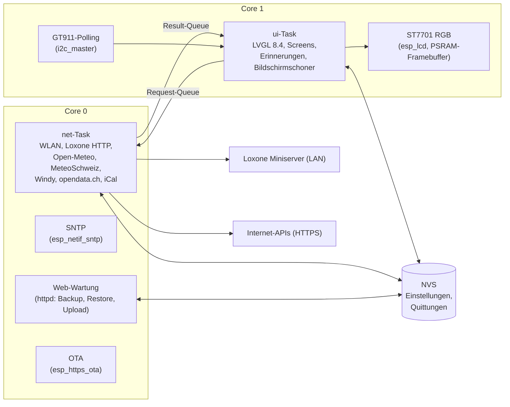

Wichtige Dateien in `main/`:

| Datei | Inhalt |
|---|---|
| `main.cpp`, `app_main.cpp` | Start, Tasks, UI-Loop |
| `panel_hw.cpp` | ST7701, Backlight, GT911-Treiber |
| `panel_ui.cpp`, `panel_ui_*.inc` | alle Screens, Gesten, Erinnerungen, Info-Seiten |
| `net.cpp`, `info_net.cpp` | Netzwerk-Task, Wetter/ÖV/Warnungen |
| `loxone_*.cpp/.h` | Miniserver-Client, Struktur, Auth |
| `webcams.cpp`, `ical.cpp` | Windy, iCal-Parser |
| `settings.cpp`, `maint.cpp`, `sys.cpp` | NVS, Web-Wartung/Backup, OTA |
| `clock_sync.cpp` | SNTP, Zeitzone |
| `diag.cpp`, `test_harness.cpp` | Diagnose und serieller Test-Harness |

## Build & Flash

Voraussetzung: **ESP-IDF 6.1** (v6.x). LVGL 8.4 kommt aus der Component Registry (`main/idf_component.yml`, fixiert in `dependencies.lock`), ArduinoJson liegt unter `components/`. Kein Arduino-Core.

```powershell
. $HOME\esp\v6.1\esp-idf\export.ps1      # Linux/macOS: . ~/esp/esp-idf/export.sh
idf.py set-target esp32s3                 # einmalig
idf.py build
idf.py -p COM14 flash monitor             # Port anpassen!
```

> **Immer den Port explizit mit `-p` angeben.** Ohne `-p` sucht `idf.py` selbst und erwischt unter Umständen ein anderes Gerät (z. B. einen 3D-Drucker).

Falls das Flashen nicht startet: BOOT halten, Flash starten, BOOT loslassen.

### Konfiguration und Geheimnisse

| Datei | Im Git? | Inhalt |
|---|---|---|
| `sdkconfig.defaults` | ja | Flash/PSRAM, CPU, Watchdogs, LVGL, FreeRTOS-Stats, Projektoptionen ohne Geheimnisse |
| `sdkconfig.defaults.local` | **nein** (gitignored) | Windy-API-Key, privater iCal-URL u. ä. – wird von `CMakeLists.txt` automatisch angehängt |
| `sdkconfig.defaults.local.example` | ja | Vorlage ohne echte Werte |
| `main/panel_config.h` | **nein** (gitignored) | WLAN- und Miniserver-Zugang (Vorlage `main/panel_config.example.h`) |
| `sdkconfig` | – | generiert, nicht von Hand bearbeiten |

```powershell
cp sdkconfig.defaults.local.example sdkconfig.defaults.local
cp main/panel_config.example.h main/panel_config.h
# beide Dateien ausfüllen, dann: idf.py reconfigure build
```

`main/panel_config.h`:

```c
#define WIFI_SSID "your-ssid"
#define WIFI_PASSWORD "your-wifi-password"
#define LOXONE_HOST "192.168.1.77"   // nur Host/IP, ohne http:// und Pfad
#define LOXONE_PORT 80
#define LOXONE_USER "your-user"
#define LOXONE_PASSWORD "your-password"
#define LOXONE_AUTH "basic"
```

Beim ersten Start einer lokal gebauten Firmware werden diese Werte nach NVS übernommen (`settings_seed_from_build`). Danach lebt alles in NVS – auch über OTA-Updates mit Release-Images, die keine Geheimnisse enthalten. Ohne Konfiguration zeigt das Panel „nicht konfiguriert“ statt eines falschen Online-Zustands. Projektoptionen: `idf.py menuconfig` → „Loxone panel“.

Partitionen (`partitions.csv`): NVS, PHY, zwei OTA-App-Slots, `coredump` (Auswertung mit `idf.py coredump-info`).

## Einstellungen am Panel

| Eintrag | Inhalt |
|---|---|
| WLAN | Netzsuche, Passwort, Fallback auf alte Zugangsdaten bei Fehler |
| Wetter-Ort | Suche über Open-Meteo-Geocoding (Standard Buchs SG) |
| Bildschirm | Timeout, Bildschirmschoner (Schwarz / Digital / Analog), Hinweis an/aus |
| Uhrzeit | NTP-Server (Presets oder eigener), Zeitzone |
| Kameras | Windy-Webcams hinzufügen/löschen, eigener API-Key (maskiert) |
| ÖV | Haltestelle suchen |
| Kalender | iCal-URL (Familie), Abfuhrkalender |
| Erinnerungen | an/aus je Quelle, Vorlaufzeit |
| Wartung | Status, Web-Wartung, OTA-Update, Update-URL |

Alle Werte liegen in NVS (Namespace `panel`). Geheimnisse (WLAN-Passwort, Miniserver-Passwort, API-Key, iCal-URL) werden am Display maskiert und im Log nie ausgegeben.

## Gesten

| Geste | Wirkung |
|---|---|
| Tippen | Kachel/Button auslösen (Feedback nur beim Tippen, nicht beim Wischen) |
| Wischen links/rechts | Seite wechseln (Kategorien, Wetter-Tage, Kameras, ÖV) |
| Vom unteren Rand nach oben | zurück zu Home |
| Vom rechten Rand nach links | zurück zu Home |
| Wischen nach rechts in Untermenü | zurück zu Einstellungen |
| Beliebiger Touch bei dunklem Display | aufwecken (Touch wird verschluckt) – Ausnahme: „OK“ einer Erinnerung quittiert direkt |

## OTA & Releases

Releases entstehen per Tag-Workflow (`.github/workflows/release.yml`):

1. `version.txt` erhöhen (setzt `PROJECT_VER`), committen.
2. Tag pushen: `git tag v0.7.2 && git push origin v0.7.2`.
3. GitHub Actions baut im Container `espressif/idf:v6.1` aus einem **sauberen Checkout** – ohne `sdkconfig.defaults.local` und ohne `panel_config.h`. Der Workflow bricht ab, falls eine dieser Dateien im Repo liegt, und prüft, dass Windy-Key und iCal-URL im `sdkconfig` leer sind.
4. Das Release erhält `loxone_panel.bin` und `loxone_panel.bin.sha256`.

Zusätzlicher Geheimnis-Check gegen das fertige Binary (gibt nur Namen und Längen aus, nie Werte):

```powershell
python tools/check_secrets.py loxone_panel.bin   # erwartet: 0 secret value(s) found
```

Das Panel lädt standardmäßig `https://github.com/meberli/esp_display/releases/latest/download/loxone_panel.bin` (änderbar unter Wartung → Update-URL) oder nimmt ein Upload über die Web-Wartung an.

## Test-Harness & Tools

Die Test-Firmware aktiviert einen seriellen Harness (`CONFIG_PANEL_TEST_HARNESS`, 460800 Baud) mit Befehlen wie `SHOT`, `TAP`, `SWIPE`, `STATE`, `POS`, `LIST`, `TYPE`, `SCRTO`, `REBOOT`:

```powershell
idf.py -B build-test -DSDKCONFIG="build-test/sdkconfig" -DSDKCONFIG_DEFAULTS="sdkconfig.defaults;sdkconfig.test" build
idf.py -B build-test -DSDKCONFIG="build-test/sdkconfig" -p COM14 flash
```

| Tool | Zweck |
|---|---|
| `panel_test.py` | Basis: Screenshot, Tap, Swipe |
| `swipe_test.py`, `press_test.py` | Gesten und Tap-Feedback |
| `weather_test.py`, `openmeteo_days.py` | Wetteransichten |
| `settings_test.py`, `screen_test.py` | Einstellungen, Timeout, Aufwecken, Persistenz |
| `cam_test.py` | Webcams |
| `rem_test.py` | Erinnerungen inkl. Weck-Regression |
| `wifi_test.py` | WLAN: falsches Passwort → Rückfall, Start ohne/mit falschem WLAN → Auswahl, Auto-Schliessen |
| `info_test.py`, `ota_test.py`, `ota_url_test.py` | Status, OTA |
| `v4_test.py` | Dark-Glass-Screens |
| `diag_log.py` | Live-Diagnose auch mit normaler Firmware: Touch-Rohdaten, Loop-Zeiten, Speicher; `--noreset`, `--tap`, `--raw` |
| `serial_log.py` | serielles Log |
| `check_secrets.py` | Binary auf Geheimnisse prüfen |
| `test_ical.cpp`, `test_weather_derive.cpp` | Host-Unit-Tests (`g++ -std=c++17 -I main …`) |

Beispiel: `python tools/diag_log.py --port COM14 --noreset --secs 120`.

Die normale Firmware hat zusätzlich Diagnosebefehle auf der Konsole: `DIAGTAP`, `DIAGSWIPE`, `DIAGRAW` (Touch auf Treiberebene einspeisen), `DIAGGT` (GT911-Register), `DIAGSTATS` (CPU-Last je Task).

## Datenquellen, Attribution & Nutzungsbedingungen

- **Open-Meteo** – Wetter und Geocoding, <https://open-meteo.com>, Daten unter CC BY 4.0. Nicht-kommerzielle Nutzung ohne Key.
- **MeteoSchweiz** – Warnungen und 2-Stunden-Niederschlagsprognose über die **inoffizielle** App-Schnittstelle. Keine garantierte API, kann jederzeit ändern; nur private Nutzung. Quelle wird am Panel genannt („Quelle: MeteoSchweiz“).
- **Windy Webcams** – <https://api.windy.com/webcams>, eigener API-Key nötig (Free Tier). Gemäss Windy-Bedingungen: Link zur Webcam-Seite und „Webcams provided by windy.com“ werden angezeigt, Bild-URLs nicht gespeichert, Bilder nicht hochskaliert.
- **transport.opendata.ch** – ÖV-Abfahrten, <https://transport.opendata.ch>, Fair-Use (Abfragen sparsam halten).
- **Loxone** – lokaler Miniserver; nicht mit Loxone Electronics GmbH verbunden.
- **Schriften & Icons** – Inter 4.0 (SIL OFL 1.1), Material Symbols Rounded (Apache License 2.0).

## Quellen (Hardware)

- Guition Produktseite: <https://www.guition.com/esp32-display-module/openhasp-screen>
- Guition Datenblatt (ST7701, 1-Relais-SKU): <https://www.guition.com/icms/upload/fb081940d6fc11f09850077a33e1404f/file/productmanager-productfile/19de32eaebc34ca68869b7da70d56e0b/Directory/ESP32-4848S040%20Specifications-EN_1776827930404.pdf>
- Arduino_GFX (Device-Eintrag und Init-Sequenz): <https://github.com/moononournation/Arduino_GFX>
- ha5dzs PlatformIO-Port: <https://github.com/ha5dzs/Guition-ESP32-4848S040-platformio>
- NorthernMan54 GPIO-Tabelle: <https://github.com/NorthernMan54/ESP32-4848S040>
- ESPHome Device: <https://devices.esphome.io/devices/guition-esp32-s3-4848s040/>
- HomeDing: <https://homeding.github.io/boards/esp32s3/panel-4848S040.htm>
- Look inspiriert vom [Home Assistant visionOS Theme](https://github.com/Nezz/homeassistant-visionos-theme)

## Lizenz

Lizenz: noch offen. Bis eine Lizenz festgelegt ist, gelten keine Nutzungsrechte über das gesetzlich Erlaubte hinaus. Eingebundene Drittkomponenten (LVGL, ArduinoJson, Schriften, Icons) behalten ihre eigenen Lizenzen.
